# Jardim da Equipe: Game Design Document (GDD)

Documento de design do jogo. Descreve **o que o jogo é, por que existe e como funciona**, do ponto de vista
de quem joga e de quem mantém. Os números de balanceamento ficam em [BALANCEAMENTO.md](BALANCEAMENTO.md);
como rodar, testar e publicar fica no [README](../README.md). Sempre que uma regra mudar no código, este
documento deve mudar junto (as regras puras estão em `game.py` e `catalog.py`).

Estado deste documento: reflete o jogo publicado até a rodada de fala com holofote (outubro de 2026). O que
ainda é só ideia está marcado como **planejado** na seção 14.

---

## 1. Visão geral

| Item | Descrição |
|---|---|
| Nome | Jardim da Equipe |
| Gênero | Jogo cooperativo de hábito (controle de presença gamificado) |
| Plataforma | Site responsivo (celular e computador), sem instalar nada |
| Público | Um time de estudantes que trabalha em Scrum durante um projeto de 10 semanas |
| Duração de uma "partida" | O projeto inteiro: 45 dias letivos, 5 sprints de 2 semanas |
| Jogadores | 7 pessoas na equipe e alguns convidados |
| Tom | Profissional e acolhedor; nada infantil, sem punição, sem ranking de quem está pior |

**Em uma frase:** cada pessoa cuida de uma planta que cresce quando ela aparece nas reuniões do time
(Daily, Dev e Day Closing); o time cresce junto, ganha sementes para personalizar o jardim e usa o mesmo
site para registrar a ata da daily.

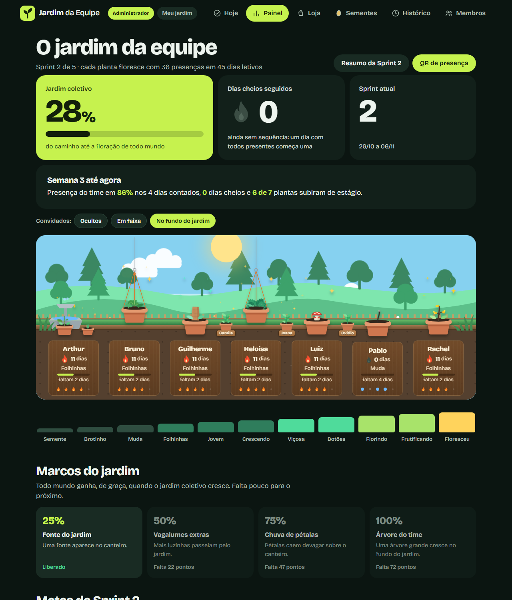

*Painel do jardim. As capturas deste documento usam um banco de demonstração, com dados fictícios.*

**Pitch para o time:** "Vir à daily faz a sua plantinha crescer. Quando todos vêm, o jardim inteiro
floresce. Nada se perde se você faltar um dia: a planta só espera você voltar."

---

## 2. Contexto e problema

A ideia nasceu de uma necessidade: **engajar os times de Scrum para participarem de forma mais ativa** da daily,
do dev e do day closing. O autor já tinha enfrentado devs com pouquíssimas pessoas e dailys em que ninguém dizia o
que tinha feito nem citava os cards.

A primeira tentativa foi um **sistema de strikes**: quem faltava três vezes pagava um doce. Melhorou um pouco o
engajamento, mas **não há como forçar ninguém a comprar a bala**, e o sistema só sabia cobrar. Havia também dois
problemas ligados:

1. **Presença:** registrar quem veio era um ritual chato e sem retorno visível.
2. **Daily:** as pessoas escreviam a fala no celular, mas conversavam pouco. O foco ia para preencher, não
   para comunicar.

O Jardim da Equipe troca a punição por **crescimento visível** e **recompensa pela constância**, e usa o
mesmo site para organizar a daily (ata, QR de presença e rodada de fala).

---

## 3. Pilares de design

1. **Nunca punir.** A planta nunca morre. Falta tem custo pequeno e reversível, e nada do que foi ganho se
   perde. Sementes só saem quando a própria pessoa compra algo.
2. **Cooperar, não competir.** Não há ranking. A comparação entre pessoas é neutra e mostra de onde vem a
   diferença. Há bônus coletivos (dia cheio, marcos do jardim, metas da sprint).
3. **Derivar, não guardar.** Estágio, sequência e sementes são **calculados do histórico** de presenças.
   Corrigir uma presença errada recalcula tudo sozinho, sem migração.
4. **Tempo de uso curto.** Marcar presença, escrever a fala ou ser o holofote leva segundos.
5. **Falar importa.** O fluxo da daily prioriza a conversa (rodada de fala) e só depois a escrita.
6. **Sem dependências.** Python da biblioteca padrão + Flask, SQLite, HTML/CSS/JS puros. Roda no plano
   gratuito do PythonAnywhere.

### O que o jogo não faz (decisões fechadas)

- Sem strikes, prendas, vidas ou "game over". Os dados antigos continuam no banco, mas não aparecem.
- Sem sorte, caixa-surpresa ou quizzes.
- Sem recompensas "reais" estilo escolher a playlist ou liderar a reunião (incompatível com Scrum).
- Sem ranking de quem está pior; só destaques positivos.

---

## 4. Calendário e ritmo

Tudo que depende de "dias possíveis" vem de um calendário editável (tela Calendário), nunca de um número fixo.

| Campo | Padrão |
|---|---|
| Início da semana 1 | 12/10/2026 |
| Duração | 10 semanas (até 18/12/2026) |
| Sprint | 2 semanas (5 sprints) |
| Contar a partir de | 15/10/2026 (primeiro dia real de uso) |
| Feriados | 12/10, 02/11, 20/11 |
| Dias letivos | **45** (segunda a sexta, fora feriados) |
| Meta de floração | **36** presenças (80% dos dias letivos, arredondado para cima) |

Registros em dia não letivo são ignorados. Dia letivo sem registro da pessoa (pendente) também é ignorado:
esquecer de marcar não pune.

### Reuniões do dia

| Evento | Quando (referência) | O que é |
|---|---|---|
| **Daily** | início da manhã | Reunião rápida do time; tem ata |
| **Dev** | durante o dia | Trabalho em conjunto; não tem ata |
| **Day Closing** (encerramento) | 15h45 | Fecha o dia; tem ata |

O céu do jardim acompanha o horário das aulas: manhã (8h), tarde (14h) e entardecer (15h45).

---

## 5. Loop do jogo

| Escala | O que acontece |
|---|---|
| **Dia** | Marcar presença (QR, celular ou Scrum) nos eventos; escrever a fala da ata; ver a planta crescer; a chama da sequência acende |
| **Semana** | Semana fechada rende sementes extras; trilha de 10 semanas avança |
| **Sprint** | Metas da sprint do time (presença, dias cheios); resumo para a Review e a Retro |
| **Projeto** | Floração individual, marcos coletivos do jardim, bosque da equipe, loja e coleção |

Ciclo de motivação: presença, crescimento visível, sementes, personalização, orgulho de equipe.

---

## 6. Mecânicas centrais

### 6.1 Status de presença

| Status | Efeito no jogo |
|---|---|
| **Presente** | +1 de crescimento (G) e +1 na sequência (conta o dia se houver ao menos um evento presente) |
| **Avisou** (justificada) | Neutro: não soma, não desconta, não quebra a sequência, não rende semente |
| **Faltou** | -2 de G e zera a sequência (G tem piso protegido) |
| **Pendente** | Ignorado |

O clique de novo no mesmo botão volta para pendente. Presente e falta no mesmo dia: vale presença.

### 6.2 Crescimento e estágios

G vai de 0 até a meta de floração. Estágio 1 já com o primeiro dia; do estágio 2 em diante, `G >= 1 + ceil((k - 1) * (meta - 1) / 9)`
(`game.limiar_estagio`). Com a meta de 36, os limiares são 1, 5, 9, 13, 17, 21, 25, 29, 33 e 36: uma subida a cada
4 dias letivos, inclusive na primeira semana.

| Estágio | 0 | 1 | 2 | 3 | 4 | 5 | 6 | 7 | 8 | 9 | 10 |
|---|---|---|---|---|---|---|---|---|---|---|---|
| Nome | Semente | Brotinho | Muda | Folhinhas | Jovem | Crescendo | Viçosa | Botões | Florindo | Frutificando | **Floresceu** |

- **Piso protegido:** uma falta nunca derruba a planta abaixo do início do estágio já alcançado.
- **Floresceu é permanente.** Depois disso, cada 5 presenças além da meta rendem 1 **fruto** (até 5).
- **Duas camadas:** tronco permanente (estágio) e copa viva (vigor).

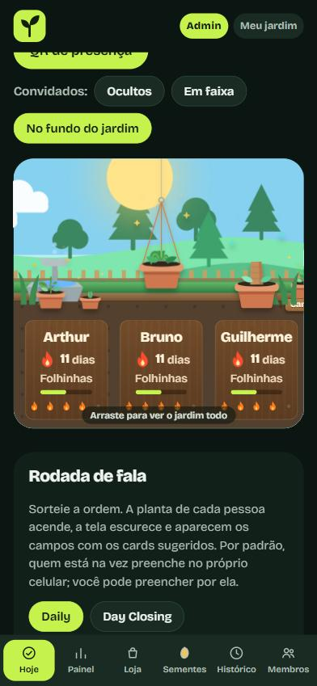

*Tela Hoje no celular.*

### 6.3 Vigor e chama (a "copa viva")

A sequência atual muda só o **visual**, sem semente nem multiplicador. O vigor e a chama usam faixas diferentes:

| Sequência | Vigor da planta |
|---|---|
| 0 | murcha (reversível na hora; nunca esqueleto) |
| 1 a 2 | verde |
| 3 a 4 | viçosa |
| 5 a 9 | florida |
| 10+ | radiante |

| Sequência | Chama (foguinho) |
|---|---|
| 0 | apagada |
| 1 a 2 | nível 1 |
| 3 a 6 | nível 2 |
| 7 a 13 | nível 3 |
| 14+ | nível 4 |

Cada planta também mostra, na placa, a barra do próximo estágio e a semana (5 dias, com a chama de cada dia).
Há um balão de sede quando o dia ainda não foi regado e uma "rega" visual quando a presença é marcada.

### 6.4 Dia cheio do time

Quando todos os ativos da equipe (convidados não contam) estão presentes e ninguém tem falta, é **dia cheio**: +1
semente para cada presente, e a sequência de dias cheios cresce. Quem marcou **Avisou** também impede o dia cheio
(decisão do autor: o dia cheio celebra o time inteiro na sala).

### 6.5 Semana fechada

Semana com presenças suficientes (mínimo ajustado em semana com feriado) rende +3 sementes na data em que o
mínimo foi atingido.

---

## 7. Economia: sementes

As sementes são sempre **derivadas** do histórico. Nunca são gravadas, só as compras. Saldo é
`ganho - gasto`, com mínimo 0. Uma correção retroativa que derrube o ganho abaixo do gasto mostra saldo 0 e
bloqueia compra nova, mas nunca remove o que já foi comprado.

### 7.1 Fontes

| Fonte | Valor | Observação |
|---|---|---|
| Presença em evento | +1 por evento | Daily, Dev e Encerramento |
| Semana fechada | +3 | Uma vez por semana |
| Marco de sequência | +3 (5 dias), +5 (10), +10 (20), +20 (40) | Uma vez cada; não é multiplicador |
| Dia cheio do time | +1 | Para cada presente |
| Floresceu | +20 | Uma vez |
| Boas-vindas | +20 | Na primeira presença |
| Ata preenchida | +1 por ata (Daily e Day Closing) | Fala com conteúdo; só em dia letivo |
| Bônus de relator (Scrum) | +1 por fala de **outra pessoa** que o Scrum preenche | Máximo 3 por ata; só vale se o Scrum entrou com o PIN e é o relator da ata |
| Meta com recompensa | 1 a 30 por meta (recomendado 3 a 10) | Definida pelo admin; só rende se cumprida até o prazo |
| Impedimentos, campo de revisão, escolha de cards do GitLab | 0 | Nunca rendem semente |

**Total de referência:** o perfil "dedicado" (todos os eventos, todos os dias, fala nas duas atas) chega a
**375** sementes no projeto; o "típico" a cerca de 275. O bônus de relator e as metas com recompensa ficam
fora desses totais. A conta completa está em [BALANCEAMENTO.md](BALANCEAMENTO.md).

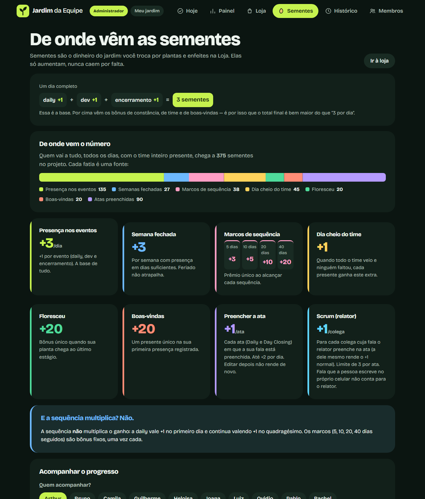

*Aba Sementes: cada fatia da barra é uma fonte de sementes.*

### 7.2 Aba Sementes

Mostra o extrato linha a linha de cada pessoa (data, motivo, valor e acumulado), as fontes e uma comparação
neutra entre duas pessoas com "de onde vem a diferença". O total do extrato é sempre igual ao saldo real.

---

## 8. Loja, coleção e personalização

Tudo na loja é **cosmético**: nada aqui muda o quanto a planta cresce.

### 8.1 Catálogo

| Tipo | Itens (preço em sementes) |
|---|---|
| Espécies | Muda comum (0), Girassol (40), Samambaia (40), Cacto (50), Lavanda (50), Cerejeira (70), Bambu (70), Cogumelo (80), Bonsai (90), Jabuticabeira (90), Planta carnívora (110), Planta-jarro (110), Ipê amarelo (120), Baobá (120, só depois de **Floresceu**) |
| Vasos | Terracota (0), Lata (12), Cerâmica azul (16), Xícara (20), Vaso roxo (24), Vaso dourado (30) |
| Companheiros | Joaninha (20), Borboleta (24), Vagalume (30), Passarinho (40), Gato dorminhoco (50) |
| Acessórios | Laço (16), Óculos (20), Chapéu de palha (24); Selo Fundador (exclusivo, fora da venda) |
| Plantas extras | Segunda plantinha (60), Terceira plantinha (110, exige a segunda) |

Raridades: comum, rara, épica e lendária. A planta extra cresce junto da principal, sempre um pouco menor
(estágio visual a 80% do principal), e **nunca altera o crescimento real**.

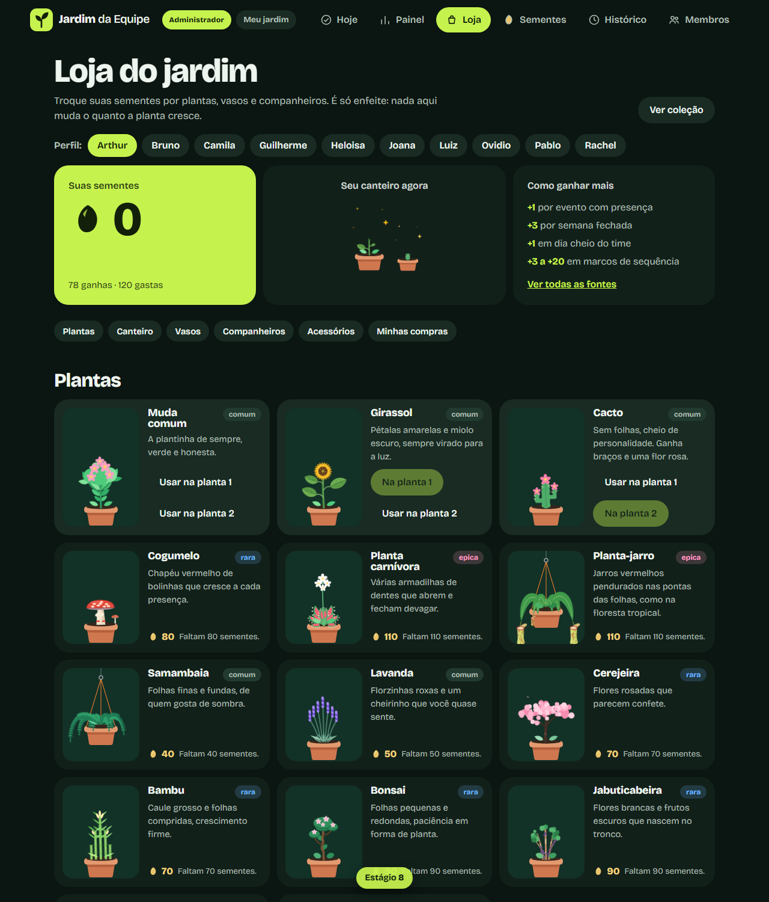

*Loja. Samambaia e planta-jarro aparecem pendurados; o botão "Estágio" no canto inferior mostra a prévia em qualquer estágio.*

### 8.2 Regras

- Cada pessoa cuida da própria loja. O administrador pode comprar e equipar em qualquer perfil.
- **Desfazer compra:** cada pessoa pode desfazer até **2 compras** no projeto inteiro e recupera as sementes.
- **Prévia de estágio:** botão fixo na loja para ver a vitrine em qualquer estágio de 1 a 10.
- **Fundador:** quem registrou presença até a data de corte (padrão 23/10/2026) ganha o selo exclusivo.
- **Coleção** (álbum) mostra o que a pessoa tem e as silhuetas do que falta.

---

## 9. Jogo coletivo

- **Progresso do jardim:** soma do crescimento de todos dividido pelo máximo possível. Desbloqueios
  coletivos gratuitos: **25%** fonte, **50%** vagalumes extras, **75%** chuva de pétalas, **100%** árvore do time.
- **Bosque da equipe:** quem floresce vira árvore fixa no bosque.
- **Metas da Sprint:** o time define 1 a 3 metas de engajamento (porcentagem de presença, dias cheios, dias
  cheios seguidos). O progresso é derivado; ao bater, a sprint ganha um selo. Sem recompensa em sementes.
- **Metas com recompensa:** combinados do admin (ex.: entregar certos artefatos até quarta) com prazo,
  sementes (1 a 30) e destinatários (time inteiro ou pessoas). O admin marca como cumprida; se for dentro do
  prazo, as sementes entram no extrato. Perder o prazo não tira nada de ninguém.
- **Resumo da Sprint:** página imprimível para a Review e a Retro, só com dados do time e destaques positivos.
- **Panorama do grupo:** visão do projeto, da sprint ou da semana.

---

## 10. Daily, ata e rodada de fala

Este é o coração "Scrum" do site. A ata registra o que cada pessoa falou, e o jogo recompensa quem
participa sem avaliar o conteúdo.

### 10.1 Ata

- Uma ata por dia e por reunião (**Daily** e **Day Closing**), com um **relator (Scrum)**.
- Campos por pessoa (Daily): **o que fiz de ontem para hoje**, **o que vou fazer hoje** e **cards aguardando
  revisão** (este último não rende semente). Day Closing: **o que concluí hoje** e **o que fica para amanhã**.
- Impedimentos: um geral do dia e um pessoal por pessoa. Nunca rendem semente.
- Exportação em português (padrão) ou inglês, com linha "Excused" para quem avisou e links dos cards do
  GitLab. Dá para copiar para o Google Docs.
- O relator edita qualquer ata de qualquer aparelho. Quem não é relator edita só a própria fala.

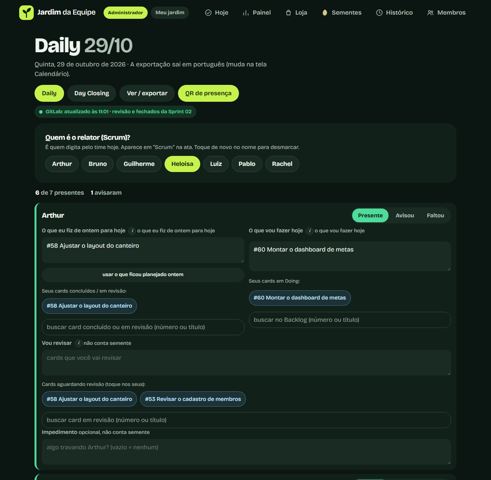

*Ata da Daily.*

### 10.2 QR e celular pessoal

- O Scrum abre o **QR de presença** (um código que muda a cada 10 minutos). Quem lê marca a própria presença
  naquele evento e, se quiser, já escreve a fala. A fala é salva mesmo que o QR mude enquanto a pessoa escreve;
  só a presença exige o código ainda válido.
- Cada pessoa entra em **Meu jardim** com um **PIN** (guardado com hash scrypt, com limite de tentativas).
  Ali vê a própria planta, a loja e escreve a fala, que é salva enquanto ela digita e ao trocar de app.

### 10.3 Integração com o GitLab

Um script no computador do dono lê o quadro do GitLab da faculdade e **empurra um retrato** para o site
(o site nunca fala com o GitLab). Os cards aparecem como sugestões nos campos da ata, só os da **milestone da
sprint atual** nas colunas Waiting review, Review e fechados. Há busca por número ou título. Escolher card
**não rende semente**.

### 10.4 Rodada de fala com holofote

Fluxo desenhado para a conversa vir antes da escrita:

1. Na tela **Hoje**, o Scrum escolhe **Daily** ou **Day Closing** (depois das 15h45 abre na Day Closing) e
   clica em **Sortear a ordem e começar**. Entram todos que ainda não foram marcados como Avisou ou Faltou.
2. A cada pessoa, a **planta dela acende** (holofote), o resto da tela escurece e sobe um **painel** com os
   campos da reunião e os **cards sugeridos** do GitLab.
3. **Quem preenche:**
   - Por padrão a **pessoa preenche no próprio celular** (logada em Meu jardim). Todos veem o texto aparecer.
   - O Scrum pode alternar a qualquer momento para **"Eu preencho por ela(e)"** e escrever pela pessoa.
4. No painel o Scrum marca **Presente, Avisou ou Faltou**. Avisou e Faltou passam para a próxima pessoa.
5. O painel mostra para **todos** a posição e quem vem a seguir ("2 de 7 · A seguir: Ana, Bia e mais 3"). A ordem
   sorteada fica no servidor: outro aparelho do Scrum que abrir a tela Hoje continua a mesma rodada.
6. A rodada também abre na tela de um **dia que já passou**, para fazer a ata daquele dia com o time. O painel
   mostra "Ata de 28/10", lê e grava a ata daquele dia, e escrever a fala não marca presença.
7. **Anterior, Próxima, Sortear de novo, Encerrar rodada** e **Fechar** (esconder o painel só para quem
   fechou). O holofote se apaga ao encerrar ou sozinho depois de 3 horas.
8. O QR e a ata continuam funcionando em paralelo.

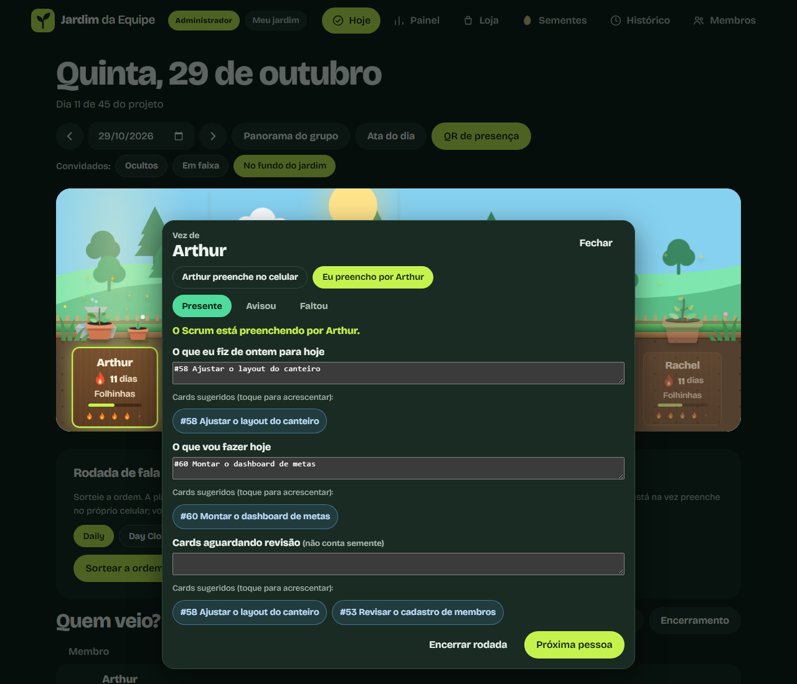

*Rodada de fala. A planta da vez fica acesa e o Scrum, ao assumir o preenchimento, toca nos cards sugeridos para acrescentá-los.*

**Sementes na rodada:** a pessoa ganha a semente da fala como se tivesse preenchido a ata; o Scrum ganha o
bônus de relator quando preenche por ela. Se a pessoa escreve a própria fala **na sua vez**, isso também
marca a presença dela (como o QR). Fora da vez, escrever de casa não marca presença.

**Frequência de atualização:** com holofote aceso, o painel consulta o servidor a cada **1 segundo**; até 10
minutos depois, a cada 5 segundos; parado, a cada 30 segundos. Abas escondidas (celular com a tela apagada)
não consultam, e ao voltar para a aba a consulta é imediata. Isso protege a cota de processamento do plano
gratuito.

---

## 11. Papéis e acesso

| Papel | Quem | Pode |
|---|---|---|
| **Administrador** | Quem entrou com o `ADMIN_CODE`, ou quem usa o computador onde o site roda (localhost) | Tudo: presença de todos, ata, membros, calendário, metas, QR, loja de qualquer perfil, banco |
| **Scrum do dia** | Membro logado com PIN que é o relator de uma ata de hoje | O mesmo que o administrador (inclusive trocar o Scrum, membros e calendário), por decisão do autor; conduz a ata e a rodada de fala e ganha o bônus de relator |
| **Membro logado** | Qualquer pessoa com PIN | Escreve a própria fala, mexe na própria loja e vê tudo |
| **Visitante** | Quem só tem o código de acesso do site | Só vê |

Além disso, o site inteiro pode ficar atrás de um **código de acesso** (variável `ACCESS_CODE`), com limite
de tentativas por IP e cookies seguros. Segredos (`ACCESS_CODE`, `ADMIN_CODE`, `SECRET_KEY`, `SYNC_TOKEN`)
nunca vão para o repositório.

---

## 12. Direção de arte e interface

- **Estilo:** ilustração vetorial (SVG) em tons, cantos arredondados, sem contorno forte. Jardim em colinas
  em camadas, cerca, terraço e placas de madeira com textura. Tema escuro com acentos em verde-limão.
- **Plantas:** cada espécie é desenhada em camadas por estágio (0 a 10) e trocada só por atributos
  (`data-stage`, `data-vigor`), sem recarregar a página. As espécies principais foram redesenhadas a partir de
  fotos de referência, com poucas partes bem desenhadas, tons de luz e sombra e padrões da natureza (como a
  espiral de sementes do girassol).
- **Espécies:** 14 (muda, girassol, cacto, cogumelo, carnívora, planta-jarro, samambaia, lavanda, cerejeira,
  bambu, bonsai, jabuticabeira, ipê e baobá). Samambaia e planta-jarro são **vasos pendurados** por fios.
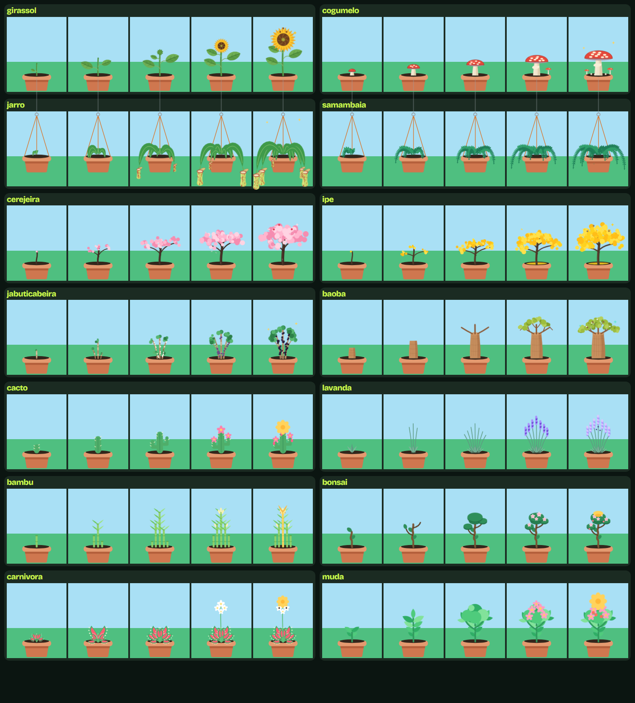

*Espécies em cinco estágios (2, 4, 6, 8 e 10). Samambaia e planta-jarro são vasos pendurados.*

- **Cena:** o céu muda com o horário das aulas; convidados aparecem em três modos (ocultos, em faixa ou no fundo
  do jardim, com cartão ao passar o mouse); placa de cada pessoa mostra nome, chama, estágio, barra e semana.
- **Movimento:** brisa suave, rega, confete ao subir de estágio e holofote na rodada de fala. Tudo respeita
  `prefers-reduced-motion`.
- **Navegação:** barra inferior no celular (Hoje, Painel, Loja, Sementes, Histórico, Membros) e menu no topo
  no computador; selo de administrador no topo.
- **Plantas extras:** ficam agrupadas ao vaso principal para que todos os cartões do canteiro tenham a mesma
  largura (ter uma planta a mais não afasta a pessoa do time). No mapa do Painel o vaso principal fica no
  meio do canteiro, as extras em vasos ao lado, e cada outra espécie comprada (que não está em uso) nasce
  solta na terra do canteiro, até 4: comprar uma planta nova sempre aparece no jardim.

---

## 13. Stack e arquitetura

### 13.1 Stack utilizada

| Camada | Tecnologia | Por quê |
|---|---|---|
| Linguagem do servidor | **Python 3.9+**, biblioteca padrão | Simples de manter e roda no plano gratuito |
| Framework web | **Flask 3** (única dependência, `requirements.txt`) | Leve; rotas, sessões e templates sem excesso |
| Banco de dados | **SQLite 3** (arquivo `data/strikes.db`) | Sem servidor de banco; persistente no PythonAnywhere; backup é copiar um arquivo |
| Templates | **Jinja2** (vem com o Flask) | HTML renderizado no servidor, com macros para planta, cena e espécies |
| Interface | **HTML, CSS e JavaScript puros** (sem framework e sem bibliotecas externas) | Sem etapa de build e sem dependências para quebrar |
| Arte | **SVG** inline gerado por macros Jinja e por `scripts/gerar_especies.py` | Plantas leves, sem arquivos de imagem, reativas ao estágio por atributos `data-*` |
| Tipografia | Fonte local (Bricolage Grotesque, `static/fonts`) | Sem pedir nada a servidores externos |
| Tempo real | **Polling** com `fetch` (1 s, 5 s ou 30 s conforme o holofote) | O plano gratuito não sustenta conexões longas (websocket) |
| QR de presença | `qr_puro.py` (gerador de QR em Python puro) + HMAC com janela de 10 min | Sem biblioteca externa |
| Senhas dos PINs | `scrypt` da biblioteca padrão | Hash com sal; limite de tentativas |
| Testes | **unittest** (mais de 600) + `node --check` para validar o JavaScript embutido | Rodam sempre contra um banco temporário |
| Controle de versão | **Git** e **GitHub** (repositório público) | Histórico de cada fase |
| Hospedagem | **PythonAnywhere** (plano gratuito, `wsgi.py`) | Disco persistente para o SQLite e HTTPS; atualização por `git pull` e Reload |
| Integração | **API do GitLab** da faculdade, lida por `scripts/sync_gitlab.py` no computador do dono | O servidor público não alcança o GitLab; recebe só um retrato por `POST` com token |
| Ferramentas de apoio | Agentes de IA (Claude Code e Kiro), Chrome sem janela para capturas de tela | Ver [PROCESSO.md](PROCESSO.md) |

### 13.2 Visão geral da arquitetura

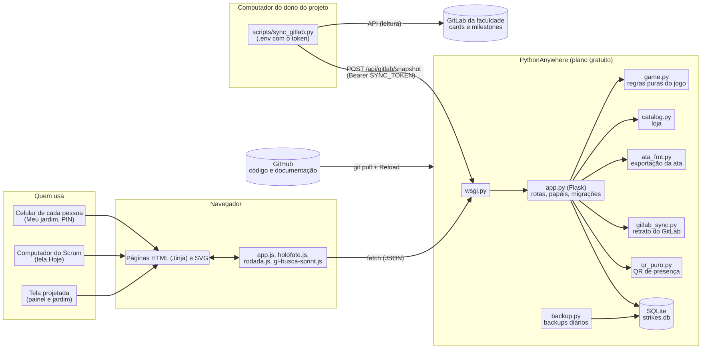

Código Mermaid deste diagrama

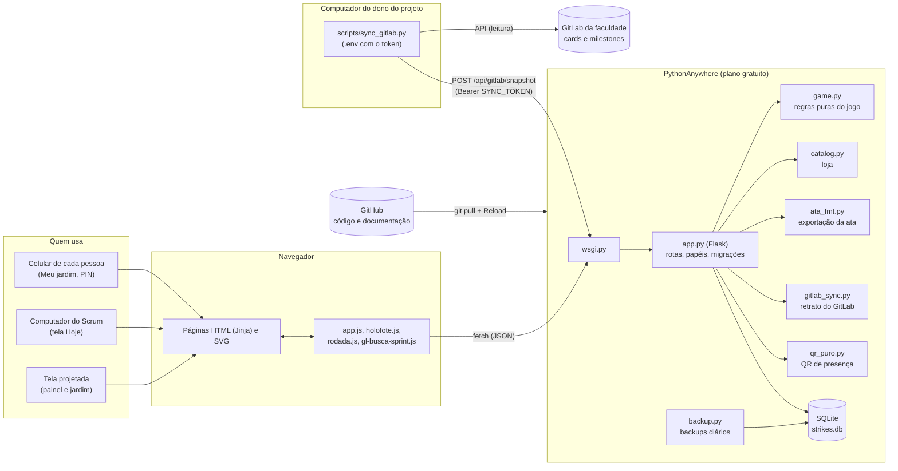

### 13.3 Como o estado do jogo é derivado

O banco guarda **fatos** (quem veio, o que foi escrito, o que foi comprado). Tudo que parece "pontuação" é
**calculado** pelas funções puras de `game.py`. Corrigir um fato errado recalcula o resto sem migração.

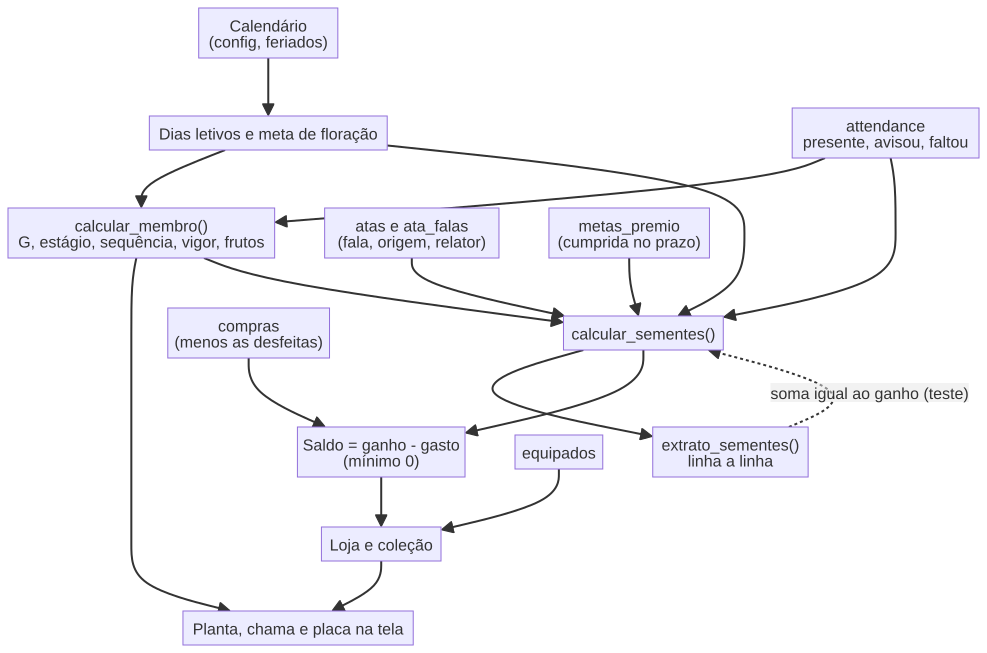

Código Mermaid deste diagrama

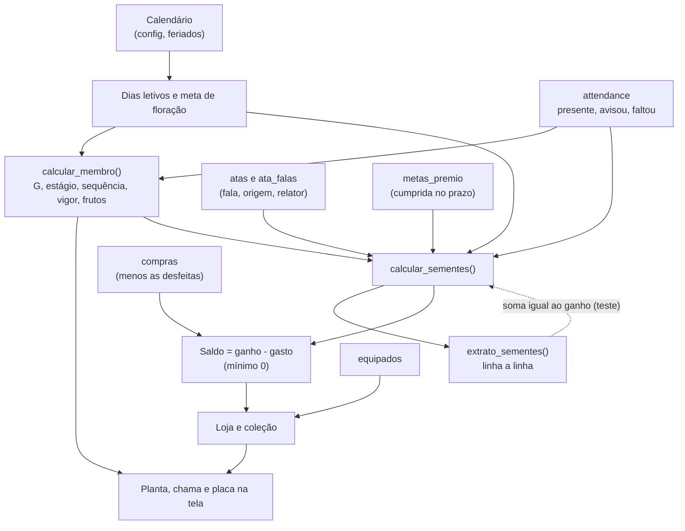

### 13.4 Modelo de dados

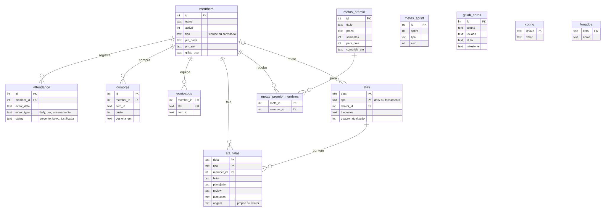

Código Mermaid deste diagrama

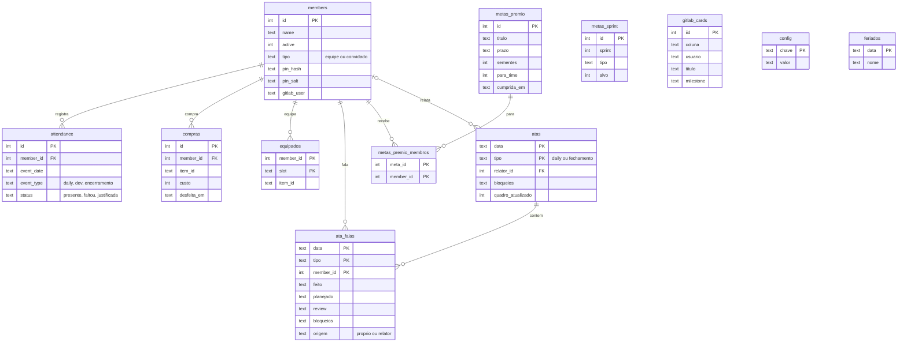

Tabelas auxiliares não desenhadas: `gitlab_usuarios` (lista de usuários do GitLab para o mapeamento automático) e
`prenda_payments` (dados antigos da época das prendas, mantidos no banco e sem uso na interface).
`config` também guarda o estado do holofote (`holofote_membro`, `holofote_modo`, `holofote_tipo`, `holofote_em`) , a
ordem sorteada da rodada (`holofote_ordem`, ids separados por vírgula) e o dia da ata (`holofote_data`), apagados ao encerrar.

### 13.5 Rodada de fala: quem fala com quem

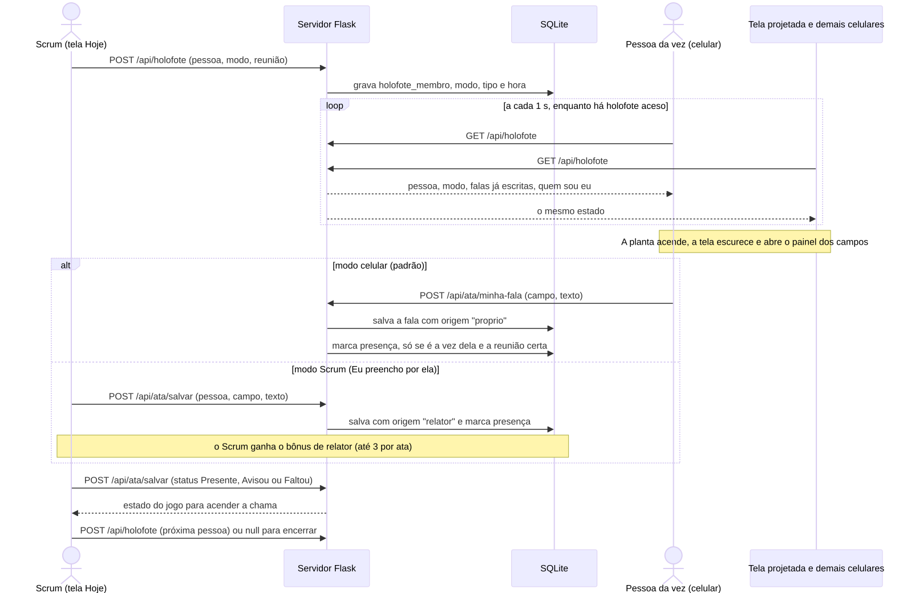

Código Mermaid deste diagrama

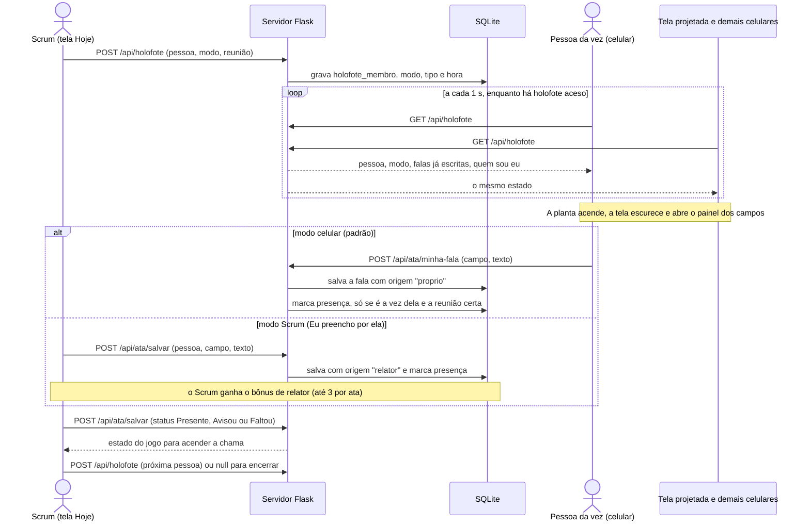

### 13.6 Publicação

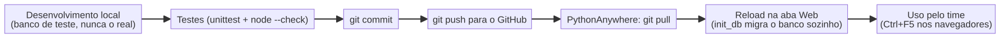

Código Mermaid deste diagrama

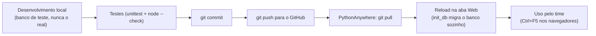

### 13.7 Princípios

- **Derivar do histórico:** estágio, sequência, sementes e metas são recalculados; o banco guarda presenças,
  compras, atas e configuração.
- **Migrações aditivas e idempotentes:** o banco publicado é atualizado sozinho no Reload, sem apagar nada.
- **Banco real intocável em testes:** testes e demonstrações rodam em cópias (`STRIKES_DB`).
- **Estado leve de tempo real:** o holofote é uma linha de configuração lida por polling, sem websocket
  (o plano gratuito não sustenta conexões longas).
- **Regras puras:** o que decide pontuação fica em funções sem Flask nem banco, fáceis de testar.
- **Um fuso só:** datas e horas do servidor seguem Brasília (`TZ`, padrão `America/Sao_Paulo`); o SQLite continua em UTC
  só para carimbos internos (`datetime('now')`).

---

## 14. Ideias e backlog (planejado, nada disto está no jogo)

| Ideia | Resumo |
|---|---|
| **Cartas do time (roguelike)** | A cada N dias aparecem 3 cartas e cada pessoa escolhe um upgrade (ex.: bônus de sementes para planta desértica, ou mais sementes conforme a raridade da planta). Exige teto de bônus por carta e fonte própria no extrato |
| **Minigames de cuidado** | Painel no celular com regar, tirar pragas e afagar o gato; até +0,5 semente por cuidado, máximo +1,5 por dia, só com presença marcada, sem punição |
| **Reações na daily** | Um toque numa fala ("quero ajuda nisso"); bônus coletivo se o time reagir |
| **Pacote da Sprint** | Bônus por sprint com 70% ou mais de presença |
| **Retro do jardim** | Aprendizado escrito na retro rende sementes |
| **Agradecimentos entre colegas** | Com limite semanal para evitar combinação |
| **Animações reativas** | Regador na presença, estágio novo com brilho e balão, boas-vindas à volta de uma falta, bichinhos no bosque, estações por sprint |
| **Clima real** | Céu e chuva acompanhando a previsão do tempo (precisa de aprovação por usar rede externa) |

---

## 15. Riscos e decisões em aberto

| Tema | Situação |
|---|---|
| Cota de processamento do plano gratuito | O polling do holofote é adaptativo (1 s, 5 s, 30 s) e pausa em aba escondida; acompanhar o uso na aba de CPU do PythonAnywhere |
| Atraso para ver o primeiro holofote | Quem está com o celular aberto e parado vê o painel em até 30 segundos; depois disso é quase imediato |
| PIN e login | Se a pessoa não está logada, ninguém escreve no celular dela; o Scrum usa "Eu preencho por ela(e)" |
| Bônus de relator | Só conta se o Scrum entrou com o PIN e é o relator da ata |
| Escrita simultânea | Se o Scrum e a pessoa mexem no mesmo campo ao mesmo tempo, vale a última escrita |
| Ordem do sorteio | Fica no servidor (`holofote_ordem`); quem sorteia de novo troca a ordem para todos |
| Fuso horário | O servidor publicado roda em UTC; o `app.py` usa `America/Sao_Paulo` quando a variável `TZ` não está definida, para o "hoje" não virar o dia seguinte às 21h |
| Metas com recompensa | O teto é o bom senso do grupo; recomendação de 3 a 10 sementes por meta |
| Calendário | Padrões assumidos (início 12/10, fim 18/12, feriados) devem ser confirmados com o time |

---

## 16. Glossário

| Termo | Significado |
|---|---|
| **G** | Pontos de crescimento da planta (0 até a meta de floração) |
| **Dia letivo** | Segunda a sexta, fora feriado, dentro do período contado |
| **Dia cheio** | Dia em que todos da equipe estão presentes |
| **Semana fechada** | Semana com presenças suficientes |
| **Floresceu** | Estágio 10, permanente |
| **Relator / Scrum** | Quem digita e conduz a ata do dia |
| **Holofote** | Destaque na planta de quem está falando na rodada de fala |
| **Ata** | Registro da daily ou da Day Closing |
| **Sprint** | Bloco de duas semanas do projeto |
| **Fundador** | Quem registrou presença até a data de corte e ganha o selo exclusivo |
