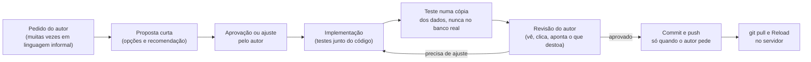
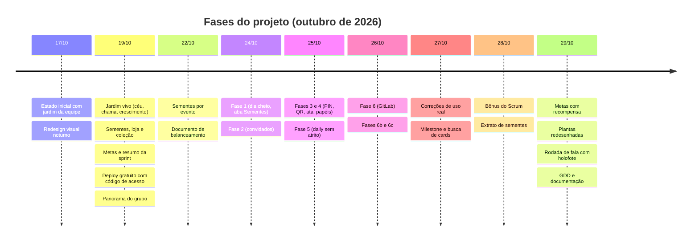

# Jardim da Equipe: relato do processo de criação

Este documento conta **como o projeto foi feito**: o problema de origem, o método de trabalho, a linha do tempo,
as notas de versão (patch notes), os problemas que apareceram e como foram corrigidos, e o que se aprendeu.
Foi escrito para servir de base a um relatório de iniciação científica. As regras do jogo em si estão no
[GDD](GDD.md), e as contas de balanceamento em [BALANCEAMENTO.md](BALANCEAMENTO.md).

Fontes usadas aqui: o histórico do Git (48 commits entre 17 e 29 de outubro de 2026), os documentos de passagem
entre agentes (`HANDOFF-KIRO.md` e `HANDOFF-KIRO-2.md`) e as conversas de desenvolvimento. Datas e números vêm
do repositório; o que é interpretação está identificado como tal.

---

## 1. Resumo

| Item | Valor |
|---|---|
| Produto | Site de controle de presença gamificado para um time Scrum de estudantes |
| Período coberto | 17 a 29 de outubro de 2026 (13 dias; 48 commits) |
| Tamanho atual | cerca de 6,8 mil linhas de Python, 1 mil de JavaScript, 1,9 mil de CSS e 4 mil de templates (inclui as espécies geradas) |
| Testes automatizados | de 48 (primeira versão das regras) para mais de 600 |
| Dependências | uma: Flask |
| Publicação | PythonAnywhere (plano gratuito), código no GitHub |
| Autoria | Um estudante, em parceria com agentes de IA (ver seção 3) |

**Ideia central:** trocar uma contagem de faltas com punição por uma planta que cresce a cada presença, e usar o
mesmo site para organizar a daily (ata, QR de presença e rodada de fala).

---

## 2. Problema de origem

O time registrava presença nas reuniões de Scrum (Daily, Dev e Day Closing) com **faltas e prendas**. Três
problemas foram observados em uso:

1. **Clima de cobrança:** a contagem de faltas punia e não incentivava vir.
2. **Registro sem retorno:** marcar presença era trabalho sem nenhuma recompensa visível para ninguém.
3. **Daily escrita, não conversada:** as pessoas se concentravam em preencher a fala no celular e conversavam
   pouco. Em palavras do autor, o time estava "muito focado em escrever as dailys e se esquecendo de comunicar".

Hipótese de partida (a ser testada, não demonstrada): *crescimento visível e recompensas leves por constância
aumentam a presença e a participação, sem o efeito negativo da punição*.

---

## 3. Método de trabalho

### 3.1 Papéis

| Papel | Quem | O que fez |
|---|---|---|
| Autor, dono do produto e do time | Estudante | Definiu o problema, as regras, o tom, aprovou ou recusou cada proposta e testou em uso real |
| Agente principal de IA | Claude Code | Planejou, implementou, testou e revisou; mediou a integração com o trabalho do outro agente |
| Agente secundário de IA | Kiro | Implementou fases a partir de documentos de passagem (hand-off); deixava as mudanças sem commit para revisão |

**Transparência sobre o uso de IA.** A maior parte do código foi escrita por agentes de IA sob direção do autor.
Decisões de produto, prioridades, tom, regras de justiça e a validação em uso real foram humanas. Isso deve
ser declarado em qualquer relatório que use este material.

### 3.2 Ciclo de cada mudança

Pontos que se repetiram e foram combinados desde cedo:

- **Brainstorm antes de construir** em temas de design (recompensas, animações, fluxo da daily): o agente
  apresenta opções e uma recomendação; o autor aprova.
- **Nunca mexer no banco real** em testes: usa-se uma cópia (`STRIKES_DB`) ou um banco de demonstração.
- **Commit e push só quando o autor pede**, e depois do commit o agente sempre lembra os comandos para atualizar
  o servidor.
- **Testes escritos junto do código**, e o agente roda a suíte inteira antes de dizer que terminou.
- **Documentos de passagem** entre agentes, para um segundo agente continuar sem perder o contexto.

### 3.3 Revisão do trabalho do segundo agente

O Kiro implementava fases e deixava tudo sem commit. O agente principal revisava o que mudou (diferenças,
testes e conferência visual numa cópia) antes de commitar. Esse passo encontrou, por exemplo, testes que
deixavam conexões do SQLite abertas e davam erro no Windows (ver problema P2).

### 3.4 Estratégia de qualidade

| Prática | Para quê |
|---|---|
| Regras do jogo em funções puras (`game.py`) | Testar sem servidor e sem banco |
| Estado derivado do histórico | Corrigir um dado recalcula tudo, sem migração |
| Migrações aditivas e idempotentes | O banco publicado se atualiza sozinho no Reload |
| Banco de demonstração (`scripts/criar_banco_demo.py`) | Testar e fotografar sem tocar nos dados reais |
| Teste de sintaxe dos scripts embutidos (`node --check`) | Pegar erro de JavaScript que antes só aparecia no navegador |
| Invariantes testadas (ex.: soma do extrato = saldo real) | Impedir que duas telas contem a mesma coisa de formas diferentes |
| Backups diários automáticos | Proteger os dados reais |

---

## 4. Linha do tempo

### 4.1 Fases e o que cada uma buscava

| Fase | Data | Objetivo | Resultado |
|---|---|---|---|
| A | 17/10 | Tirar punição; planta que cresce; status "Avisou"; calendário editável | Jogo de crescimento por estágios e vigor, banco migrado sem perda |
| B | 19/10 | Economia e personalização | Sementes, loja, coleção, plantas extras |
| C | 19/10 | Jogo coletivo | Metas da sprint, resumo para a Review, marcos, bosque |
| D | 19 e 25/10 | Publicar de graça e com acesso controlado | PythonAnywhere, código de acesso, banco fora do repositório, backups |
| 1 a 2 | 24/10 | Corrigir o dia cheio; convidados | Aba Sementes, boas-vindas, convidados no fundo do jardim |
| 3 e 4 | 25/10 | Presença pelo celular e ata | PIN, QR com janela de 10 minutos, ata da daily, papéis de administrador |
| 5 | 25/10 | Preencher a daily sem atrito | Presença e fala em sequência, edição da própria linha |
| 6, 6b, 6c | 26/10 | Ligar a daily ao quadro do GitLab | Cards como sugestões, três campos da daily, exportação em português |
| Uso real | 27 a 29/10 | Ajustar o que o uso real mostrou | Ver patch notes e problemas |
| Visual e daily | 29/10 | Plantas melhores e conversar mais na daily | Redesenho das espécies, rodada de fala com holofote |

---

## 5. Patch notes

Notas por data, em ordem cronológica. Cada item aponta uma mudança observável; o hash do commit fica entre
parênteses para quem quiser ver o detalhe no repositório.

### 17/10/2026: ponto de partida

- **Novo:** controle de presença com jardim da equipe, banco real SQLite, calendário editável (`4b7bf52`).
- **Alterado:** a contagem de faltas com prendas sai da interface; os dados antigos continuam no banco.
- **Novo:** redesign visual noturno, logo e navegação para celular (`4a48667`).

### 19/10/2026: jardim vivo, economia e publicação

- **Novo:** céu por horário, crescimento diário, foguinho de sequência com quatro níveis (`e42138b`).
- **Novo:** sementes, loja, coleção e plantas extras (`65f4b9a`).
- **Novo:** metas da sprint, resumo para a Review, marcos coletivos, bosque e trilha (`b2ad86b`).
- **Novo:** publicação gratuita com código de acesso e backup agendado (`a4de854`).
- **Novo:** panorama do grupo, destaques com empate e plantas com desenho próprio (`606f990`).

### 22 a 24/10/2026: equilíbrio e convidados

- **Alterado:** sementes por evento (daily, dev e encerramento) e preços dobrados; documento de balanceamento
  (`c0c0d46`, `ca5112c`).
- **Corrigido:** dia cheio contava errado; ganhou aba Sementes, próximos marcos e boas-vindas (`b853a31`).
- **Novo:** membros convidados e jardim redesenhado com convidados no fundo (`c1dc3f9`).
- **Novo:** documento de passagem para o segundo agente (`7fc0c61`).

### 25/10/2026: celular pessoal, ata e papéis

- **Novo:** login por PIN, QR de presença, ata da daily e papéis de administrador (`e1245f9`).
- **Alterado:** banco fora do repositório e variáveis `ADMIN_CODE` e `ADMIN_LOCAL` documentadas (`9bea363`, `8a1e402`).
- **Corrigido:** botões do administrador quebravam linha no topo (`46ce1b8`).
- **Novo:** preencher a daily sem atrito: presença e fala em sequência e edição da própria linha (`565a60d`).

### 26/10/2026: integração com o GitLab

- **Novo:** cards do GitLab sugeridos na daily; testes que não dependem do relógio (`c474855`).
- **Novo:** mapeamento automático de pessoas pela API do GitLab e vários destinos no script (`42e165b`).
- **Novo:** três campos na daily com cards (fiz, vou fazer, vou revisar), backlog, fechados e exportação em
  português (`f7b3f86`).
- **Novo:** chips e impedimento por pessoa na presença pelo QR (`7f7e288`).

### 27/10/2026: correções de uso real

- **Corrigido:** a tela Membros não adicionava ninguém por causa de um erro de sintaxe no JavaScript; ganhou um
  teste que valida a sintaxe dos scripts (`1673d13`).
- **Alterado:** Review, Waiting review e fechados passam a mostrar só a milestone da sprint atual, que muda
  sozinha (`5c71531`).
- **Novo:** busca de cards em "O que fiz" e "Vou revisar" (`fa9f335`).
- **Corrigido:** os links dos cards na exportação saíam sem o caminho do projeto; agora usam a URL exata de cada
  card (`6c273f7`).
- **Novo:** a Day Closing também ganhou os cards do GitLab e as buscas (`56cc183`).

### 28/10/2026: justiça do bônus e transparência

- **Novo:** o Scrum ganha +1 por fala de outra pessoa que preenche; estágios do dia nos horários das aulas
  (`496c19b`).
- **Alterado:** o bônus do Scrum passa a ter limite de 3 por ata; a aba Sementes ganha extrato linha a linha e
  explica por que duas pessoas têm saldos diferentes (`07495b1`).
- **Novo:** metas com recompensa em sementes (prazo, para o time ou para pessoas) e rótulo da daily
  "O que eu fiz de ontem para hoje" (`af88de1`).

### 29/10/2026: visual e a conversa da daily

- **Alterado:** plantas extras maiores e agrupadas ao vaso; limite de 2 desfazimentos de compra por pessoa
  (`db5a5a8`).
- **Novo:** oito espécies redesenhadas a partir de fotos de referência, gerador de espécies e prévia de estágio
  na loja (`36ae07a`).
- **Novo:** planta-jarro, vasos pendurados (samambaia e jarro), cartões iguais no canteiro e prévia compacta
  (`a9e2814`).
- **Novo:** rodada de fala com holofote na planta da tela principal (`82bb361`, `ad6bc5d`) e também na Day
  Closing (`6121c4d`).
- **Corrigido:** seleção do seletor Daily e Day Closing sem destaque (`62d4557`).
- **Corrigido:** painel do holofote sem Avisou e Faltou, saída que não liberava a tela, chama que não acendia e
  clique que atravessava o painel (`1dbea6a`).
- **Alterado:** holofote mais ágil, presença ao escrever na própria vez, 24 testes do fluxo e o GDD (`4a5c8ee`).

---

## 6. Decisões de design e seus motivos

| Decisão | Motivo |
|---|---|
| A planta nunca morre; falta custa pouco e é reversível | Evitar o clima de cobrança e a ansiedade de sequência observada em apps de hábito |
| Sem ranking; comparação neutra | O objetivo é cooperar; mostrar "quem está pior" pioraria o clima |
| Sementes derivadas, nunca gravadas | Corrigir um dado errado recalcula tudo e impede divergência entre telas |
| Sem multiplicador de sequência | Evitar efeito bola de neve que pune quem quebra uma sequência |
| Marcos de sequência em valores fixos | Recompensa de constância sem risco de perder o que já ganhou |
| Cosméticos na loja, sem efeito no crescimento | Gastar sementes não pode virar vantagem nem desvantagem real |
| Sem recompensas "reais" tipo escolher a playlist ou liderar a reunião | Recusadas pelo autor: infantis e incompatíveis com o Scrum |
| Cooperação em vez de competição (dia cheio, marcos do jardim) | O time cresce junto |
| Limite de 3 por ata no bônus do Scrum | Evitar que o relator "farme" sementes |
| Bônus pelo preenchimento, nunca pelo conteúdo | Evitar avaliar a qualidade do que é escrito |
| Rodada de fala "falar primeiro, escrever depois" | Escolha do autor para atacar o problema da daily escrita sem conversa |
| Polling em vez de websocket | O plano gratuito não sustenta conexões longas |
| Plano gratuito como restrição de projeto | A arquitetura (um arquivo SQLite, uma dependência, polling adaptativo) nasceu dessa restrição |

---

## 7. Problemas encontrados e correções

Esta é a parte mais útil para análise. Cada linha traz o problema, **como foi percebido**, a causa e o que
foi feito. Quando houve uma prática nova a partir do erro, ela está destacada.

| # | Problema | Como foi percebido | Causa | Correção e aprendizado |
|---|---|---|---|---|
| P1 | O botão Adicionar da tela Membros não funcionava | Uso real: o autor tentou adicionar um convidado | Um erro de sintaxe no JavaScript, introduzido na Fase 6, derrubava todos os botões da página | O erro foi corrigido e foi criado um teste que checa a sintaxe de todos os scripts embutidos. **Prática nova:** nenhum JS sem checagem de sintaxe |
| P2 | 69 testes davam erro no Windows | Ao revisar o trabalho do segundo agente | Conexões SQLite abertas e nunca fechadas, que travavam a remoção do arquivo | Auxiliar que abre e fecha a conexão. Aprendizado: revisar o trabalho de outro agente antes de commitar |
| P3 | Dois testes de metas quebraram sozinhos | Quando a Sprint 1 acabou | Os testes dependiam da data de hoje | A data foi fixada nos testes. **Prática nova:** testes não podem depender do relógio |
| P4 | O QR mostrava o IP da rede local mesmo no site publicado | Uso em produção | O endereço da rede era usado sempre | Só usa o IP quando o host é localhost |
| P5 | Links dos cards na exportação saíam errados | O autor comparou com o link real do GitLab | Faltava o caminho do projeto no endereço-base | Passa a guardar a URL exata de cada card; a base é corrigida a cada sincronização |
| P6 | O script de sincronização enviava para o computador local, não para o site | O GitLab "não mudava" no site publicado | O `.env` apontava para `localhost` | Dois destinos (`SITE_URL_PRODUCAO` e `SITE_URL_LOCAL`) e a opção `--destino` |
| P7 | A aba Sementes não batia com o saldo real | O autor perguntou por que duas pessoas no mesmo dia tinham saldos diferentes | A aba não contava ata e bônus do Scrum, contava por dia e não por evento e não descontava compras | Aba reconstruída com extrato linha a linha e teste de invariante (soma do extrato igual ao saldo). **Prática nova:** duas telas nunca contam a mesma coisa por caminhos diferentes |
| P8 | A Day Closing não tinha os cards do GitLab | O autor notou ao usar | A lógica só tinha sido feita para a daily | Generalizada para as duas reuniões |
| P9 | Convidados escondidos atrás das plantas e layout alto no celular | Revisão visual do autor | Sobreposição por z-index e altura da cena | Convidados em faixa ou no fundo, com cartão ao passar o mouse |
| P10 | Botões do administrador quebravam linha no topo | Uso no celular | Largura insuficiente | Rótulos curtos no celular e mesma altura |
| P11 | O bônus do Scrum podia ser abusado | Discussão de design com o autor | Sem limite, o relator ganharia muito por ata | Limite de 3 por ata e marca de quem escreveu cada fala |
| P12 | Cards de sprints antigas apareciam nas sugestões | Uso real | Sem filtro por milestone | Filtra pela milestone atual, que muda sozinha |
| P13 | As plantas pareciam "feitas de folhas aleatórias" | O autor comparou o girassol e a cerejeira com fotos reais | Desenho por acúmulo de partes, sem seguir a anatomia da planta | Redesenho a partir de referências, com poucas partes bem desenhadas. **Prática nova:** gerar espécies por código (`scripts/gerar_especies.py`) e registrar o método numa skill |
| P14 | Quem comprava uma planta extra parecia "separado" dos colegas | Observação do autor | O cartão ficava mais largo e deixava um vão no canteiro | Cartões de largura igual e plantas agrupadas ao vaso |
| P15 | O botão "Avisou" do painel não parecia selecionado | Teste do autor | O botão só mudava depois da resposta do servidor, com atraso de até 3 s | Atualização imediata na tela, antes da resposta. Aprendizado: feedback visual precisa ser instantâneo |
| P16 | O clique atravessava o painel e mexia no que estava atrás | Teste do autor | A camada escura não segurava cliques e o botão do painel acionava o do controle escondido | A camada escura segura os cliques e o painel grava a situação ele mesmo |
| P17 | O seletor Daily e Day Closing não mostrava qual estava ativo | Teste do autor | O JavaScript marcava o botão com uma propriedade e o CSS lia outra | Alinhado ao padrão dos outros chips do site |
| P18 | Os cards sugeridos não apareciam para o Scrum no modo "a pessoa preenche no celular" | Teste do autor | Só quem editava o campo via os cards | Os cards aparecem para todos; só quem edita pode tocá-los |
| P19 | O Scrum clicou sem querer em "a pessoa preenche" e ficou sem saída | Teste do autor | O botão de voltar ficava no rodapé do painel, fora da vista | Dois botões lado a lado no topo, que alternam o modo a qualquer momento |
| P20 | Sair do painel não desligava o holofote da tela | Teste do autor | Fechar escondia o painel mas mantinha o escurecido | Fechar libera a tela de quem fechou; Encerrar rodada apaga para todos |
| P21 | A chama não acendia ao marcar presença pela rodada | Teste do autor | Só os botões da tabela de presença atualizavam a chama na tela | O servidor devolve o estado do jogo e a tela aplica; função reutilizável |
| P22 | O painel consultava o servidor a cada 3 s em toda aba aberta | Revisão do fluxo, antes do uso real | Risco de estourar a cota de processamento do plano gratuito | Consulta adaptativa (1 s com holofote, 5 s logo depois, 30 s parado) e pausa em aba escondida. **Aprendizado:** a cota do plano molda a arquitetura |
| P23 | Quem escrevia a própria fala na sua vez continuava sem presença marcada | Teste de fluxo de ponta a ponta (24 casos) | O preenchimento pelo Scrum marcava presença e o da própria pessoa não | Presença marcada só na vez dela e na reunião certa, para não permitir marcar de casa |
| P24 | A prévia de estágio na loja cobria os preços | Teste do autor | Botão grande e fixo | Botão compacto |
| P25 | Não havia como marcar "Faltou" na ata | Pedido do autor | A ata tinha só Presente e Avisou | Terceiro botão e suporte no servidor |

### 7.1 Padrões que se repetem

1. **Erros que só o uso real mostra** (P1, P4, P5, P6, P9, P10, P12): o desenvolvimento em ciclos curtos com o
   autor testando no dia a dia foi o que os encontrou. Testes automatizados não os pegariam sozinhos.
2. **Duas verdades para o mesmo dado** (P7, P21, P23): sempre que dois caminhos mudavam o mesmo estado de
   formas diferentes, apareceu inconsistência. A resposta foi centralizar e testar invariantes.
3. **Feedback visual que não segue o estado** (P15, P17, P19, P20): detalhes de interface que o teste
   automatizado não vê e o autor percebeu em segundos.
4. **Limites do ambiente moldam o projeto** (P22): a cota do plano gratuito virou requisito de design.
5. **Revisão cruzada entre agentes** (P2): o trabalho de um agente foi revisado por outro antes de ir para
   o repositório.

---

## 8. Métricas e evidências disponíveis

| Evidência | Onde está |
|---|---|
| Histórico das mudanças | `git log` (48 commits; cada fase em commits próprios) |
| Regras e números do jogo | [GDD.md](GDD.md) e [BALANCEAMENTO.md](BALANCEAMENTO.md) |
| Testes | `tests/` (mais de 600); fluxo da rodada de fala em `tests/test_holofote_fluxo.py` |
| Decisões e passagens entre agentes | `HANDOFF-KIRO.md` e `HANDOFF-KIRO-2.md` |
| Capturas de tela | `docs/img/` |
| Dados antigos de punição | Mantidos no banco (`prenda_payments`), sem uso na interface; podem servir de **linha de base** |

---

## 9. Lições aprendidas

1. **Comece pelos dados, derive o resto.** Guardar só fatos e calcular pontuação evitou a maioria das
   divergências e deixou as correções baratas.
2. **O ambiente é um requisito.** Usar o plano gratuito forçou escolhas (SQLite, uma dependência, polling) que
   simplificaram o sistema.
3. **Brainstorm antes de código** em decisões de design reduziu retrabalho; quase todas as recusas do autor
   aconteceram na proposta, não depois da implementação.
4. **Testes de fluxo de ponta a ponta acham incoerências** que testes unitários não acham (P23).
5. **Testar numa cópia dos dados reais, nunca neles**, deu segurança para experimentar.
6. **Mostrar para quem usa.** As correções mais valiosas vieram de o autor clicar no sistema e dizer "isto
   está estranho".
7. **Documentar para o próximo agente.** Os documentos de passagem permitiram revezar agentes sem perder
   contexto.
8. **Nomear o que a IA fez e o que o humano decidiu** ajuda a avaliar o processo e a reproduzi-lo.

---

## 10. Limitações e ameaças à validade

- **Sem avaliação formal de impacto.** Ainda não há medição de que a presença ou a participação melhoraram. O
  que existe é a construção do sistema e o uso inicial.
- **Amostra pequena e conhecida:** um time de 7 pessoas mais convidados, no mesmo curso e no mesmo projeto.
- **Autor também é usuário:** o autor é parte do time, o que enviesa a avaliação.
- **Efeito de novidade:** o interesse inicial por um sistema novo tende a cair depois de algumas semanas.
- **O desenho é do próprio time:** as regras refletem o gosto e o contexto deste grupo e podem não servir para outros.
- **Uso de agentes de IA:** parte do código não foi escrita à mão; a qualidade foi garantida por testes e
  revisão humana, e não por inspeção linha a linha.

---

## 11. Sugestões para a iniciação científica

Perguntas de pesquisa possíveis:

1. A gamificação cooperativa (planta que cresce, sem punição) aumenta a **presença** nas cerimônias de Scrum
   em comparação com a contagem de faltas anterior?
2. A **rodada de fala com holofote** aumenta a participação oral e a qualidade da comunicação na daily,
   comparada ao preenchimento só escrito?
3. Quais mecânicas são percebidas como **justas ou injustas** (por exemplo, o bônus do Scrum e o dia cheio)?
4. Como o uso de **agentes de IA** altera o processo de desenvolvimento de um produto por um estudante
   (velocidade, tipos de erro, papel da revisão)?

Medidas que o sistema já registra ou pode registrar com pouco esforço:

| Medida | Origem |
|---|---|
| Taxa de presença por evento e por semana | Tabela `attendance` (já existe) |
| Linha de base com a contagem antiga de faltas | Dados antigos mantidos no banco |
| Proporção de atas preenchidas e quem escreveu (própria pessoa ou Scrum) | Campo `origem` de `ata_falas` |
| Uso da rodada de fala (quantas vezes, quanto tempo) | A registrar (hoje só guarda o estado atual) |
| Percepção de justiça e utilidade | Questionário curto (por exemplo, escala SUS) e entrevistas |

Cuidados éticos sugeridos: consentimento do time para usar os dados, anonimização (trocar nomes por códigos),
deixar claro que o jogo não pune e que participar da pesquisa não altera sementes nem plantas.

---

## 12. Como reproduzir

1. Clonar o repositório e instalar o Flask (`pip install -r requirements.txt`).
2. Criar um banco de demonstração: `python scripts/criar_banco_demo.py demo.db`.
3. Apontar o site para ele: `STRIKES_DB=demo.db python app.py` e abrir `http://localhost:5000`.
4. Rodar os testes (sempre com banco temporário): `python -m unittest discover tests`.
5. Ver o passo a passo de publicação no [README](../README.md).
